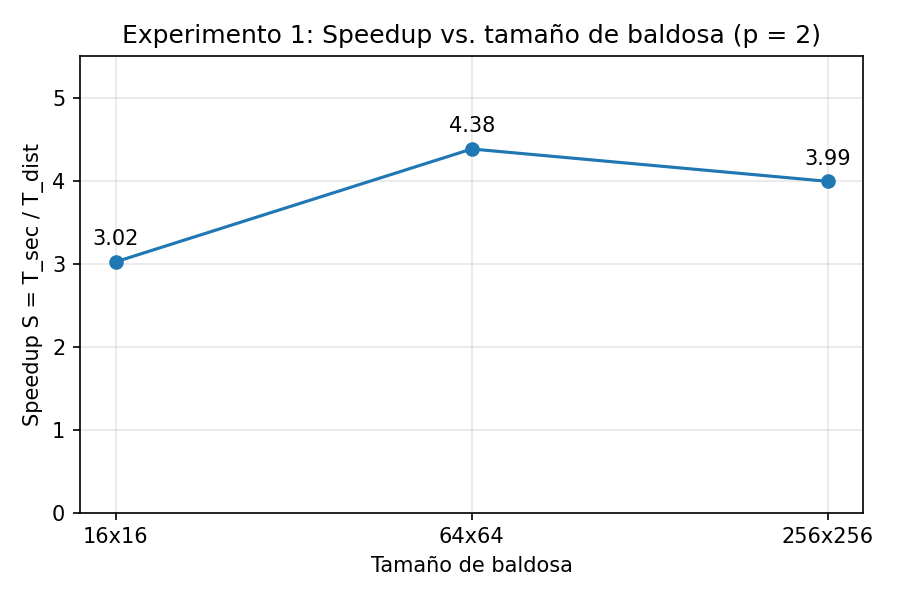
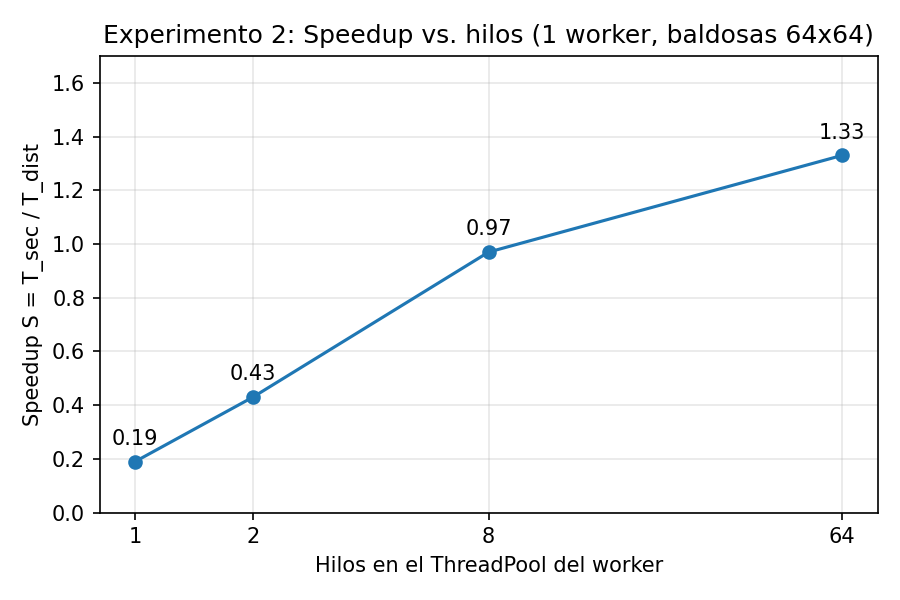
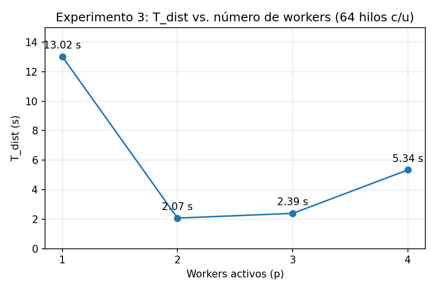

# Informe técnico: Renderizado paralelo de fractales con patrón Master-Worker

Computación en Internet I, Universidad Icesi, 2026-2 (NRC 12378 / 12377)

| Integrante                 | Código      |
|----------------------------|-------------|
| Isabella Vergara Valencia  | _A00411822_ |
| Valentina Tangarife Rincón | _A00411935_ |

## 1. Entorno experimental

### 1.1 Equipos y roles

| Rol en el clúster | Equipo | Procesador | Núcleos | RAM | Sistema operativo |
|-------------------|--------|-----------|---------|-----|-------------------|
| Maestro, cliente, Worker-2 y Worker-4 | PC de Isabella | AMD Ryzen 5 5600H with Radeon Graphics | 6 físicos / 12 lógicos | _(completar)_ | Windows |
| Worker-1 y Worker-3 | MacBook Air de Valen | Apple M_ _(completar modelo exacto)_ | 8 físicos | _(completar)_ | macOS |

Los workers se ejecutaron en **computadores distintos**. Los equipos se conectaron mediante una red privada virtual de **ZeroTier**, es decir, a través de internet y no por una red local, lo que agrega latencia respecto a una LAN.

### 1.2 Cambio al código base

En `WorkerMain.java` el worker registraba su observador ante el Maestro con la dirección `127.0.0.1`. Con workers en otro computador, el Maestro intentaba notificarlos en su propia máquina y nunca llegaba el aviso de tareas disponibles. Se agregó un **sexto argumento opcional** (la IP propia del worker, con `127.0.0.1` por defecto) que se usa para construir el endpoint del observador. Sin ese argumento el comportamiento es el original.

### 1.3 Comandos usados

```
# Maestro
./gradlew :server:runMaster --args="10000"

# Worker: puerto, nombre, IP del Maestro, puerto del Maestro, hilos, IP propia
./gradlew :worker:runWorker --args="10001 Worker-1 <IP-maestro> 10000 64 <IP-del-worker>"

# Cliente: host, puerto, ancho, alto, maxIter, estrategia (0 franjas, 1 baldosas), parámetro, preset, salida
./gradlew :client:runClient --args="<IP-maestro> 10000 1920 1080 2000 1 64 seahorse output/salida.png"
```

La estrategia de partición y su parámetro se eligen por consola en el cliente, y el número de hilos en el worker, sin recompilar.

### 1.4 Metodología y métricas

- **T_sec:** tiempo de una ejecución secuencial de un solo hilo, medido por el cliente en su propio computador justo antes de cada ejecución distribuida.
- **T_dist:** tiempo del renderizado distribuido reportado por el cliente.
- **Speedup:** S = T_sec / T_dist. **Eficiencia:** E = S / p × 100 %, con p = número de workers activos, tal como la calcula el cliente.
- En todas las ejecuciones válidas el cliente verificó que la imagen distribuida es **100 % idéntica** a la secuencial.
- Salvo que se indique lo contrario, cada configuración se ejecutó una vez.

**Sobre eficiencias mayores a 100 %:** T_sec se mide con un solo hilo, pero cada worker usa un pool de varios hilos (4 en el Experimento 1, hasta 64 en los demás). La capacidad de cómputo real es p × hilos, mayor que p, por lo que S puede superar a p y E superar el 100 %. Por ejemplo, en el Experimento 1 con 2 workers de 4 hilos hay 8 hilos de cómputo, y el mejor speedup (4,84) equivale a un 60,5 % sobre esos 8 hilos.

## 2. Fase monolítica: ejecuciones individuales

Cada integrante ejecutó el monolito con 5 configuraciones con tiempos entre 1 y 10 minutos.

### 2.1 Isabella

Detalle y evidencia en `resultados-individual/isabella-individual.md`.

| # | Preset | Resolución | maxIter | T_sec (ms) | T_sec (s) | T_sec (min) |
|---|--------|-----------|---------|-----------|-----------|-------------|
| 1 | seahorse | 1920×1080 | 20000 | 77688 | 77,69 | 1,29 |
| 2 | seahorse | 3840×2160 | 10000 | 156884 | 156,88 | 2,61 |
| 3 | seahorse | 3840×2160 | 20000 | 311560 | 311,56 | 5,19 |
| 4 | mini | 3840×2160 | 30000 | 115016 | 115,02 | 1,92 |
| 5 | elephant | 3840×2160 | 30000 | 194185 | 194,19 | 3,24 |

### 2.2 Valen

| # | Preset | Resolución | maxIter | T_sec (ms) | T_sec (s) | T_sec (min) | Imagen |
|---|--------|-----------|---------|-----------|-----------|-------------|--------|
| 1 | seahorse | 1920×1080 | 20000 | 86158 | 86.16 | 1.44 | `v1.png` |
| 2 | seahorse | 3840×2160 | 10000 | 171736 | 171.74 | 2.86 | `v2.png` |
| 3 | seahorse | 3840×2160 | 20000 | 343294 | 343.29 | 5.72 | `v3.png` |
| 4 | mini | 3840×2160 | 30000 | 142390 | 142.39 | 2.37 | `v4.png` |
| 5 | elephant | 3840×2160 | 30000 | 209335 | 209.34 | 3.49 | `v5.png` |


## 3. Experimento 1: granularidad y sobrecosto de red

Condiciones: p = 2 workers (Worker-1 en la Mac y Worker-2 en el PC), 4 hilos por worker, 1920×1080, 2000 iteraciones, preset seahorse.

| Estrategia | Parámetro | Tareas creadas | T_sec (ms) | T_dist (ms) | Speedup S | Eficiencia E (%) |
|-----------|-----------|----------------|-----------|-------------|-----------|------------------|
| FixedCount (franjas) | N = 2 | 2 | 16251 | 8941 | 1,82 | 90,9 |
| FixedCount (franjas) | N = 4 | 4 | 16498 | 4388 | 3,76 | 188,0 |
| FixedCount (franjas) | N = 16 | 16 | 16393 | 3388 | 4,84 | 241,9 |
| FixedTileSize (baldosas) | 16×16 | 8160 | 16479 | 5453 | 3,02 | 151,1 |
| FixedTileSize (baldosas) | 64×64 | 510 | 16234 | 3706 | 4,38 | 219,0 |
| FixedTileSize (baldosas) | 256×256 | 40 | 16257 | 4074 | 3,99 | 199,5 |


**Observaciones**

- Con franjas, el tiempo mejora al aumentar N: de 8941 ms (N = 2) a 3388 ms (N = 16). Con pocas franjas fijas el reparto es desbalanceado.
- Con baldosas, el grano ultrafino (16×16, 8160 tareas) es un 47 % más lento que 64×64 (510 tareas), y el grano grueso (256×256, 40 tareas) es un 10 % más lento.
- N = 16 obtuvo el menor T_dist (3388 ms) en una sola ejecución. La baldosa de 64×64 se midió cuatro veces en las mismas condiciones (2 workers, 4 hilos) y dio entre 3542 y 3769 ms, de modo que la diferencia con N = 16 es del orden de la variación entre repeticiones.
- **Decisión:** para los experimentos siguientes se fijó la estrategia de **baldosas de 64×64**, porque su desempeño es comparable al mejor caso observado y reparte el trabajo dinámicamente entre workers de distinta velocidad.

## 4. Experimento 2: concurrencia y saturación del pool de hilos

Condiciones: un solo worker (Worker-1, en la Mac de 8 núcleos físicos), baldosas de 64×64 (510 tareas), 1920×1080, 2000 iteraciones, seahorse. El Maestro se reinició en cada configuración.

| Configuración | Hilos | T_sec (ms) | T_dist (ms) | Speedup S | Eficiencia E (%) |
|---------------|-------|-----------|-------------|-----------|------------------|
| A | 1 | 16163 | 86267 | 0,19 | 18,7 |
| B | 2 | 16451 | 38163 | 0,43 | 43,1 |
| C (núcleos físicos) | 8 | 16160 | 16583 | 0,97 | 97,4 |
| D | 64 | 16126 | 12095 | 1,33 | 133,3 |



**Observaciones**

- Pasar de 1 a 2 hilos reduce el tiempo 2,3 veces, y de 2 a 8 hilos también 2,3 veces. De 8 a 64 hilos (8 veces más hilos) solo mejora 1,37 veces.
- Con 1 hilo el worker tarda 86 s frente a 16 s del T_sec. Probablemente se debe a que el worker corre en otra máquina (más lenta por hilo que el PC donde se mide T_sec) y a la comunicación por red, así que S < 1 en las primeras configuraciones no indica un error.
- La mejor configuración es la de **64 hilos** (12,1 s), que se usó en el Experimento 3 y en las combinaciones.

## 5. Experimento 3: escalabilidad del clúster y Ley de Amdahl

Condiciones: baldosas de 64×64, 64 hilos por worker, 1920×1080, 2000 iteraciones, seahorse. Los workers se fueron agregando sobre el mismo Maestro.

| Workers activos (p) | Workers | T_sec (ms) | T_dist (ms) | Speedup S | Eficiencia E (%) | S relativo a p = 1 |
|---------------------|---------|-----------|-------------|-----------|------------------|--------------------|
| 1 | Worker-1 (Mac) | 16118 | 13021 | 1,24 | 123,8 | 1,00 |
| 2 | Worker-1 (Mac) y Worker-2 (PC) | 16282 | 2070 | 7,87 | 393,3 | 6,29 |
| 3 | 3 de los 4 workers lanzados | 16285 | 2390 | 6,81 | 227,1 | 5,45 |
| 4 | Workers 1 y 3 (Mac), 2 y 4 (PC) | 16273 | 5336 | 3,05 | 76,2 | 2,44 |



**Notas**

- La fila de p = 3 corresponde a una ejecución planeada para 4 workers en la que el cliente reportó solo 3 activos. Se conserva como un dato adicional y la ejecución con 4 workers confirmados se repitió (última fila).
- El salto de p = 1 a p = 2 se debe en gran parte a que el segundo worker es un PC mucho más rápido que la Mac, y no solo a duplicar el número de nodos.
- Con p = 4 hay dos workers por computador, y los del PC comparten CPU con el Maestro y el cliente. El tiempo es 2,6 veces peor que con p = 2.

## 6. Combinaciones de la fase monolítica ejecutadas en el clúster

Condiciones: baldosas de 64×64, 64 hilos por worker. Los tiempos T_sec son los medidos por el cliente en el PC de Isabella.

| # | Preset | Resolución | maxIter | Workers | T_sec (ms) | T_dist (ms) | T_dist (s) | Speedup S | Eficiencia E (%) |
|---|--------|-----------|---------|---------|-----------|-------------|------------|-----------|------------------|
| c1 | seahorse | 1920×1080 | 20000 | 2 | 151412 | 13909 | 13,91 | 10,89 | 544,3 |
| c2 | seahorse | 3840×2160 | 10000 | 2 | 306721 | 28448 | 28,45 | 10,78 | 539,1 |
| c3 | seahorse | 3840×2160 | 20000 | 2 | 609680 | 55543 | 55,54 | 10,98 | 548,8 |
| c4 | mini | 3840×2160 | 30000 | 2 | 251087 | 18671 | 18,67 | 13,45 | 672,4 |
| c5 | elephant | 3840×2160 | 30000 | 3 (*) | 373125 | 26926 | 26,93 | 13,86 | 461,9 |

(*) En la ejecución c5 el cliente reportó 3 workers activos, y la eficiencia está calculada con p = 3.

**Observaciones**

- Para el preset seahorse el speedup se mantiene en torno a 10,8 a 11 sin importar la resolución ni las iteraciones, así que el beneficio es estable al escalar el problema.
- La combinación más pesada (c3) pasa de unos 10 minutos en secuencial a unos 55 segundos en el clúster.
- Los presets `mini` y `elephant` alcanzan speedups mayores (13,5 a 13,9).

## 7. Cuestionario de análisis conceptual

**1. Colapso por grano fino.** Con baldosas de 16×16 se crean 8160 tareas, y cada una exige al menos una llamada `pollTask()` y una `reportResult()` al Maestro (más de 16 000 llamadas RPC), además de las notificaciones. Cada baldosa tiene solo 256 píxeles, por lo que el cómputo de una tarea es comparable o menor que el costo de ir y volver por la red (aquí agravado por ZeroTier). A eso se suma el costo de serializar y deserializar en binario con Slice los datos de cada tarea y de cada resultado, la latencia de TCP por cada llamada y los cambios de contexto en el Maestro, que atiende todas esas llamadas y consolida los bloques en streaming. El resultado medido es T_dist = 5453 ms con 16×16 frente a 3706 ms con 64×64, un 47 % peor con el mismo cómputo total. Con 64×64 (510 tareas) el costo por tarea se amortiza, y con 256×256 (40 tareas, 4074 ms) empieza a perderse balanceo al final, porque quedan pocas tareas grandes.

**2. Fracaso de la partición estática.** Con FixedCount y N = 2 el tiempo fue de 8941 ms, frente a 4388 ms con N = 4 y 3388 ms con N = 16. Con franjas fijas cada worker recibe una franja predeterminada, pero el costo por píxel es muy desigual: los píxeles del interior del conjunto agotan las iteraciones, mientras que los del exterior escapan en unas pocas. El worker con la franja más densa termina mucho después y el otro queda ocioso, de modo que T_dist es el tiempo del más lento. En este montaje se agrava porque los dos workers son máquinas de velocidad distinta. El patrón Bag of Tasks divide el trabajo en muchas tareas pequeñas que los workers piden cuando quedan libres, así el worker más rápido toma más tareas y la carga se balancea dinámicamente. _(Completar con los tiempos por worker del log del Maestro, líneas «Tarea #… entregada por Worker-X», si se conservan.)_

**3. Límites del ThreadPool.** De 1 a 8 hilos (los núcleos físicos de la Mac) el tiempo bajó de 86,3 s a 16,6 s. De 8 a 64 hilos solo bajó a 12,1 s, es decir, 8 veces más hilos produjeron 1,37 veces más velocidad: no crece proporcionalmente. Pasados los núcleos físicos, más hilos no agregan capacidad de cómputo. La mejora residual se explica porque, al haber más hilos, mientras unos esperan la respuesta de red de `pollTask()` o `reportResult()` otros calculan. Sin embargo, tener muchos más hilos que núcleos genera contención de CPU y alternancia de contexto (_thread context switching_): el sistema operativo debe repartir los núcleos entre muchos hilos, con el costo de guardar y restaurar su estado y de perder localidad de caché. En un solo worker ese costo se compensó, pero en el Experimento 3 con p = 4 (dos workers de 64 hilos en cada computador) el tiempo empeoró 2,6 veces respecto a p = 2, lo que es consistente con esa contención.

**4. Ley de Amdahl.** Con S(p) = 1 / ((1 − f) + f / p), la fracción secuencial es (1 − f) = (1/S − 1/p) / (1 − 1/p). Tomando el speedup relativo a p = 1 del Experimento 3, con p = 2 y p = 3 el speedup es mayor que p (6,29 y 5,45), por lo que la fórmula da valores negativos y no es aplicable. Con p = 4 (S relativo = 2,44) se obtiene (1 − f) ≈ 0,21, es decir, cerca del 21 % secuencial. Esta cifra no es confiable: los nodos son de velocidades muy distintas, con p = 4 hay dos workers por computador compartiendo CPU con el Maestro y el cliente, y cada punto se midió una sola vez. En todo caso, la parte estrictamente secuencial del sistema la imponen la generación de tareas con la estrategia, el encolado, la atención de las llamadas del Maestro y el reensamblado de la imagen.

## 8. Limitaciones

- **Máquinas heterogéneas:** el PC (Ryzen 5 5600H) y la Mac tienen velocidades por hilo muy distintas, lo que distorsiona la comparación entre p = 1, 2 y 4 y la estimación de Amdahl.
- **Red:** ZeroTier agrega latencia respecto a una LAN, lo que penaliza las configuraciones con muchas tareas.
- **Recursos compartidos:** el PC de Isabella ejecutó a la vez el Maestro, el cliente y uno o dos workers.
- **p = 4 con dos computadores:** hubo dos workers por equipo.
- **T_sec del cliente:** se mide con el Maestro, los workers y Gradle corriendo en el mismo PC, lo que puede inflarlo respecto a una medición aislada y, con ello, el speedup.
- **Eficiencia sobre 100 %:** ver la nota de la sección 1.4.
- **Una sola medición** por configuración, salvo la repetición de la baldosa 64×64 mencionada en la sección 3.
- **Ejecuciones descartadas:** se excluyeron las ejecuciones en las que el cliente reportó 0 workers (sin cómputo) y se identificó la ejecución con 3 workers en lugar de 4.

## 9. Bitácora de uso ético de IAG (Nivel 3)

- **Herramienta:** Claude (Anthropic).
- **Asistencia recibida:**
    - Lectura del enunciado y plan para ejecutar los experimentos en el clúster.
    - Diagnóstico del problema del registro del worker con `127.0.0.1` y propuesta del cambio en `WorkerMain.java` (argumento opcional con la IP propia).
    - Depuración de errores de entorno en macOS (herramienta `slice2java` de Ice) y de Git.
    - Revisión de las salidas para detectar ejecuciones inválidas (0 workers, 3 workers en lugar de 4).
    - Organización de las tablas en Markdown.
    - Revisión de las respuestas del cuestionario, revisado y adaptado por las dos.
- **Prompts clave:** 
    - Ayúdame a entender el enunciado del proyecto y a organizar los pasos que debemos seguir para ejecutar los experimentos en el clúster. Explícame qué debemos configurar, cómo ejecutar las pruebas y qué resultados debemos registrar para el informe.
    - Tenemos un problema con el worker porque se registra utlizando la dirección 127.0.0.1, y no nos deja que otro equipo se conecte al cluster, ahí que podríamos hacer para solucionar eso? ayuda xfis.
    - Me podrías ayudar a solucionar este error que me aparece en el gradle en mi mac porque creo que está relacionado con algo del slice2java y no me deja porque creo que tiene una configuración de windows.
    - Estamos haciendo unas ejecuciones y en unos vimos viendo que unas partes dice que mno hay workers o solo 3 en vez de 4, sabes como podemos revisar o verificar si esas ejecuciones están bien?
    - Podrías revisar nuestras respuestas dle cuestionario y decirnos si les falta algo o si tienen errores?

## 10. Evidencias

- `resultados-grupal.txt`: Experimento 1 y primeras ejecuciones del Experimento 2.
- `resultados-exp3.txt`: Experimento 3.
- `resultados-combinaciones.txt`: combinaciones de la fase monolítica en el clúster.
- `isabella-IteracionesIndividual.md` y `valentina-IteracionesIndividual.md`: resultados individuales de las iteraciones y ejecución del código. Y las imagenes de cada una están en el `monolith/output/`.
- Imágenes generadas por el cliente en `client/output/`.